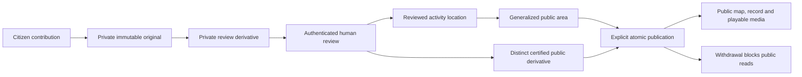

# Authenticated moderation and controlled publication

This milestone extends UI System V2 without changing its design, map engines or imagery providers. It is a native development MVP; it is **not production ready**.

## Verified baseline

Work began on a clean `feature/ui-system-v2` at `9d01c9280a2e7f809f212cfe54975f1823b37a95`. A fresh fetch confirmed `main` was still `21e34722723810f85e065481da5cfd58ded91d8d`. UI System V2 had not been merged. Its CI and main CI were successful. The only open PRs were older foundation PRs #1 and #3, neither containing this milestone. `feature/moderation-publication` was created from the accepted UI head; no automatic merge occurred. The baseline had 114 backend and 63 frontend tests.

## Identity and browser boundary

Reviewers have normalized usernames, Argon2id password hashes supplied by `pwdlib`, active state and a moderator/admin role. No password hash or reviewer identity is public. Sessions use random 256-bit opaque capabilities; only token digests are persisted. Each request checks session expiration/revocation and current account role/active state. Sessions expire after eight hours. Login rotates a previous browser session; logout and password reset revoke sessions.

The `xerxes_session` cookie is HttpOnly, SameSite=Lax, scoped to `/api/v1`, and Secure outside development/test. Production requires explicit HTTPS `APP_PUBLIC_ORIGINS`. Login requires an exact trusted browser Origin. Subsequent mutations also require the session's `X-CSRF-Token`. The web proxy forwards the browser's actual Origin, cookie and CSRF value; it does not manufacture a trusted Origin. Sensitive responses use `no-store`. Validation errors omit submitted values so passwords, private intake and upload capabilities are not reflected into errors.

Failed logins are limited to five per username in 15 minutes. Direct non-loopback peers also receive a 25-failure limit; loopback reverse-proxy peers are excluded from that bucket to prevent one attacker locking out every reviewer behind Next. Forwarded client addresses are not trusted. Distributed rate limiting and trusted production edge configuration remain necessary.

Development-only account setup, after migrations:

```powershell
apps/api/.venv/Scripts/python.exe -m xerxes_api.auth_seed --username YOUR_REVIEWER_NAME
```

Passwords are prompted, require at least 12 characters and are never placed in command arguments or source. Resetting an account revokes its sessions. The local verification account's generated credentials reside only in ignored `.local/moderation-account.json`; use the setup command to choose your own password. This file must not be shared or committed.

## Review and media trust boundaries



The real queue shows bounded pages of actual intake, coverage state, region, media/review/publication state, assignment and risk flags. Capture coordinates and private descriptions are loaded only in authorized detail. Assignment is required for moderator mutations; administrators can reassign. An observation row lock serializes changes. Published records cannot be edited until withdrawn. Review status and publication status are separate because approval alone must not make evidence public.

Private detail contains original description, manual location, capture coordinates/accuracy, original evidence metadata/hash, duplicate indicators, private review playback, reviewed geography, draft, candidate state and durable activity. Storage keys never leave the service. Original bytes require administrator access; review/thumbnail streams require an active moderator or admin. Media selectors are fixed UUID/variant routes, never browser-supplied keys. Private map tiles load only after an explicit action; capture context is a separate opt-in and is never copied into the activity location.

The original and review objects remain in private `.local/evidence` storage. Public candidates use separate immutable `.local/published` storage and a strict `published/{id}/{lease}/asset` namespace. A durable leased job re-encodes the review derivative into a new JPEG or H.264/AAC MP4 and thumbnail, strips metadata and records hashes/provenance. Preparation alone never enables delivery. The existing native media worker dispatches both job types with bounded attempts and lease ownership checks.

**Re-encoding is not content redaction.** Reviewers must inspect faces, voices, plates, landmarks and source-identifying context and explicitly certify that sensitive identifiers do not remain. If they cannot certify this, they must exclude media from publication. No automatic blur, voice alteration or AI inference is claimed.

## Geographic privacy

CaptureLocation remains private device context. ObservationLocation is a separate, explicitly saved Point/Polygon/MultiPolygon estimate. Every change retains old/new geometry, reviewer, timestamp and reason in a private location-revision table. Reviewed geometry is bounded to the Ghana navigation envelope and validated by PostGIS. A single active monitoring area covering the reviewed geometry can be assigned independently of the original capture check; outside/overlapping coverage remains explicit.

PublicLocation is generated only from ObservationLocation. The default is a fixed 2,000-metre grid in EPSG:32630 (UTM 30N), transformed back to WGS84. `PUBLIC_GRID_METERS` accepts 1000, 2000 or 5000. A point publishes its enclosing cell; a reviewed polygon publishes the full grid-aligned envelope covering it, rather than implying that its centroid is the incident point. The precision label records the grid width. This is a projected generalization, not a guarantee of anonymity.

The high-risk override publishes the complete assigned monitoring polygon and requires that polygon to cover the reviewed geometry. It does not fall back to a capture-derived point. Existing GSS district/reference vintage and topology limitations are unchanged.

## Publication and withdrawal

Approval/publication require an authenticated authorized reviewer, deliberate ObservationLocation, nonempty sanitized title and summary, reviewed summary/location checklist, explicit media include/exclude decision and a generated public area. Including media additionally requires identifier certification and a ready distinct derivative matching the immutable private review source hash.

Publication writes/upserts PublicLocation, changes the publication gate, updates the compatible public observation state, records publication time and appends an audit event in one database transaction. Files already exist behind the gate. Public map and record reads share the same publication predicate; every media GET/HEAD/range additionally checks approval, publication, location and media/privacy state. A guessed candidate UUID does not enable pre-publication access.

Withdrawal closes the map/record/media gates while preserving original evidence, reviewed geography and audit history. Every subsequent byte-range request checks visibility again. Public/private streams use controlled filenames, allowlisted media types, bounded 64KiB reads, 206/416 range handling, HEAD, no-store and no internal filesystem metadata headers. Previously downloaded bytes cannot be recalled.

Generic audit metadata contains only allowlisted identifiers/states/version information. Private decision notes are stored separately from that metadata and shown only in protected detail. Repeated processing polls deduplicate `opened_review` within ten minutes. The prior standalone publication CLI is retired; its internal metadata-only compatibility function remains for legacy tests and is not an HTTP route.

## Database and API

Migrations extend the existing chain:

| Revision                      | Changes                                                                                                                            |
| ----------------------------- | ---------------------------------------------------------------------------------------------------------------------------------- |
| `0004_moderator_sessions`     | `reviewers`, `reviewer_sessions`, durable login throttles                                                                          |
| `0005_moderation_publication` | `observation_reviews`, moderation audit events, private location revisions; preserves existing approved metadata-only publications |
| `0006_public_media`           | Distinct `published_media`, leased `public_media_jobs`, processing indexes and constraints                                         |
| `0007_private_decision_notes` | Separate private decision-note column                                                                                              |

Existing capture/activity/public location tables, upload capabilities and private worker contracts remain intact. Migration upgrade/downgrade/autogenerate checks run against real PostGIS.

| Boundary                | Routes                                                                                                                     |
| ----------------------- | -------------------------------------------------------------------------------------------------------------------------- |
| Authentication          | `POST /api/v1/auth/login`, `POST /auth/logout`, `GET /auth/session`                                                        |
| Private queue/detail    | `GET /api/v1/moderation/observations`, `GET /observations/{id}`                                                            |
| Private commands        | `POST /observations/{id}/{assign,location,draft,decision,prepare-media,publish,withdraw}` under the moderation prefix      |
| Private preview/bytes   | `GET /observations/{id}/public-location`; `GET/HEAD /observations/{id}/media/{review,thumbnail,original}` under moderation |
| Public records/features | Existing `GET /api/v1/observations/{id}` and `GET /api/v1/map/features` gain optional sanitized public-media DTOs          |
| Public bytes            | `GET/HEAD /api/v1/public-media/{id}/{asset,thumbnail}`                                                                     |

The same-origin Next proxies have exact path/method allowlists and bounded JSON, forward only required authentication/range headers and stream bytes with backpressure. Public media DTOs are validated again before client rendering; external/private/query-bearing/mismatched media URLs and unknown internal fields are excluded. Public video has controls, metadata preload, a sanitized poster and no autoplay. The map drawer shows a restrained approved thumbnail and the public-record link.

## Map loading

Renderers report a common viewport after Leaflet moveend/zoomend or Google idle. The hook owns 250ms debounce, cancellation and generation protection; fetch code remains outside rendering. National zoom does not request district data. Enabled districts begin at zoom 9 using the current bbox. Reviewed observations start enabled and are loaded by viewport. Search covers only loaded features. No vector tiles, new engine, provider or interface redesign was introduced.

Before: the Ghana-wide all-layer response was about 3,346,907 bytes / 264 features / 4.026s locally. With no published observations, national loading is 60 bytes / zero features / about 0.093s, with zero district requests. A detail bbox `[-2.1,6.3,-1.1,7.1]` returned 505,051 bytes / 42 features. These measurements use the current empty-public development dataset and local services, not a production performance promise. Viewport size still matters: a wide zoom-9 desktop bbox returned about 1.9MB, while zoom-11 desktop returned about 426KB.

## Validation

Backend from repository root:

```powershell
apps/api/.venv/Scripts/python.exe -m pip install -e "./apps/api[dev]"
apps/api/.venv/Scripts/python.exe -m ruff check apps/api/src apps/api/tests apps/api/migrations
apps/api/.venv/Scripts/python.exe scripts/run_api.py test
```

Final integrated result: **169 backend tests pass**, with one existing Starlette/httpx deprecation warning. Ruff passes. This includes real PostGIS, migration roundtrip, authentication, role/CSRF/Origin checks, private/public media, reviewed geography, high-risk coarsening, private decision notes, publication, withdrawal and sentinel privacy assertions.

Frontend from `apps/web`:

```powershell
npm.cmd ci
npm.cmd run test
npm.cmd run typecheck
npm.cmd run build
```

The integrated suite passes **93 tests** across 18 files; TypeScript and the production build pass. The clean install succeeds. These checks also validate the compatible Vitest patch and scoped PostCSS update. No framework major upgrade was introduced.

One synthetic real MP4 completed the browser workflow: contribution with actual coverage validation, private worker processing and playback, real reviewer login/assignment, deliberate reviewed map point, sanitized draft and three certifications, safe grid preview, distinct public derivative, separate approval/publication, public feature/drawer and video playback. The public video decoded at 320×180 and time advanced; a range request returned 206 with 1,024 bytes. Public JSON/HTML excluded private sentinels, capture coordinates and upload capabilities. Withdrawal removed the feature and returned 404 for record, full media, thumbnail and range requests, while private evidence and audit history remained available internally. The running worker had to be restarted after the new audit schema/model was loaded; the explicit console retry then completed normally. No database helper bypassed the review workflow.

The production build was also verified by briefly republishing the same approved test case through the console, then withdrawing it again. Public video played, the workspace loaded 35/35 visible satellite tiles and the record map loaded 15/15. There were no page errors. Final screenshots show the settled map, drawer and record; `production-results.json` records this separate check.

Local screenshots and machine-readable proof are ignored under `.local/moderation-e2e/`, `.local/moderation-ops-qa/` and `.local/moderation-viewport-browser/`. The published screenshot case is clearly synthetic. After verifying that withdrawal retained 14 audit events and the private evidence, its exact observation/media/jobs and five stored objects were removed as test-data cleanup. The seeded local development reviewer remains available for testing; prior private observations remain untouched. No synthetic record remains publicly published.

Readonly real operations browser checks at 1440/768/390 pixels verify actual login/logout, private detail, authenticated MP4 range playback, API failure/retry/empty, private map opt-in, no capture copying, no page errors and no document overflow. Viewport browser checks verify no national districts, eligible bbox requests, pan coalescing, cancellation of superseded reads and preserved camera.

The native PostgreSQL/PostGIS/API/worker/web stack is used locally. Docker CLI is unavailable, so Compose execution is not claimed; its configuration now shares separate private and public volumes between API and worker.

## Remaining limits and next milestone

Production object storage intentionally fails closed; there is no deployed S3/CDN adapter. Native public storage can retain an inaccessible orphan after a hard crash between file write and cleanup, and private-job priority can delay public preparation. Periodic public-orphan maintenance and scheduling fairness remain work. There is no reliable automatic identifier redaction, MFA, account recovery/admin provisioning UI or production edge rate-limiting setup. Geographic source quality, retention policy, backups, access monitoring and source-protection operations need further review. No new AI, satellite analytics, drone or XNP capabilities were added.

Dependency inspection applied a compatible Vitest 3.2.7 patch and a scoped Next/PostCSS 8.5.32 override; Next stays on 15.5.29. `npm audit --omit=dev` now reports zero findings. The full audit retains three dev/test package findings (one moderate, two critical) through Mocker/Tinypool/Vitest. The configured command is `vitest run` without an exposed API/UI/browser server; a reachable remote exploit was not established. Clearing those findings requires a reviewed Vitest 4 migration; forcing mismatched transitive majors beneath Vitest 3 is deliberately avoided. Audit severity is not an application exploitability finding.

**Next milestone: production evidence-storage and source-protection hardening.** Implement a private object-storage adapter, deployed identity/provisioning and operational controls, retention/withdrawal guarantees and reviewed dependency migration before considering a public beta. This should precede adding analytics to sensitive evidence.
